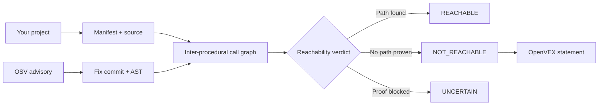
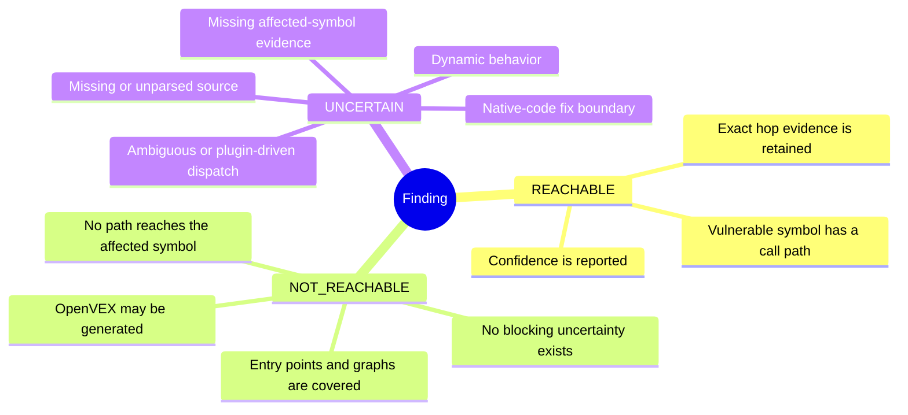
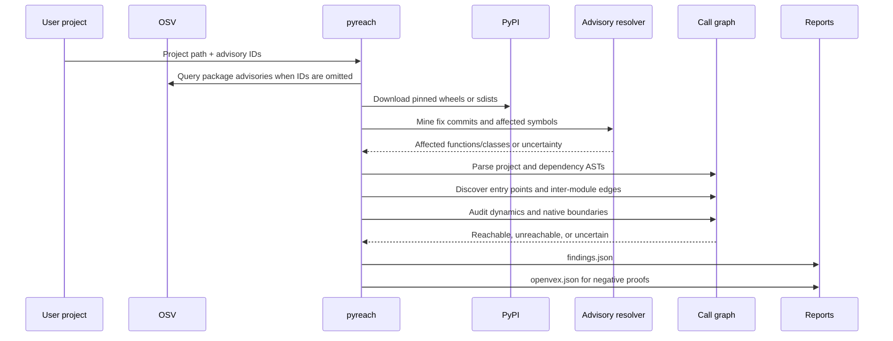
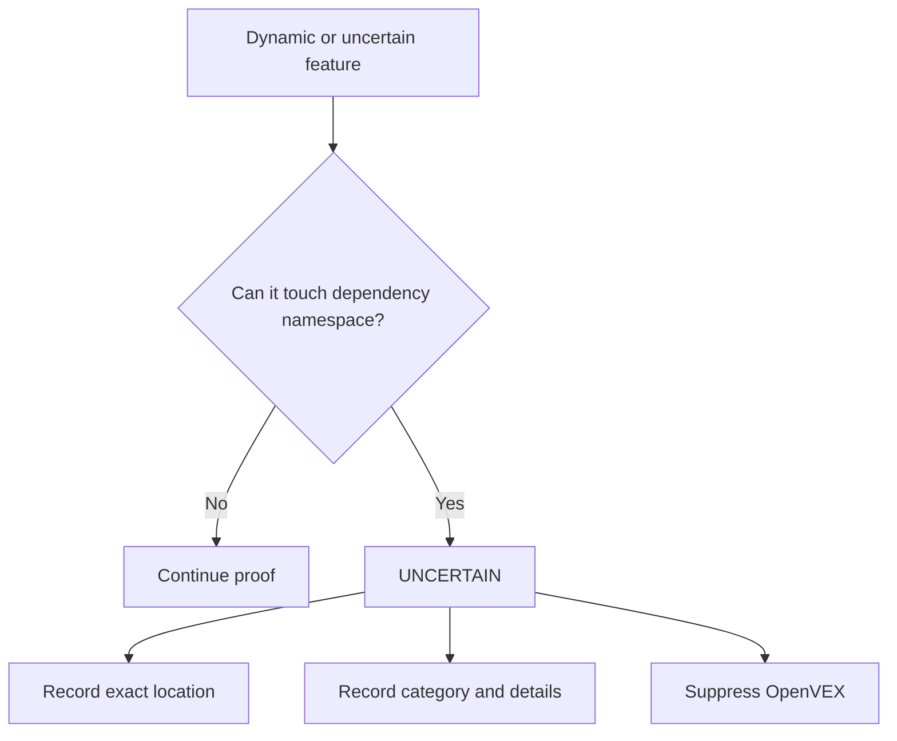
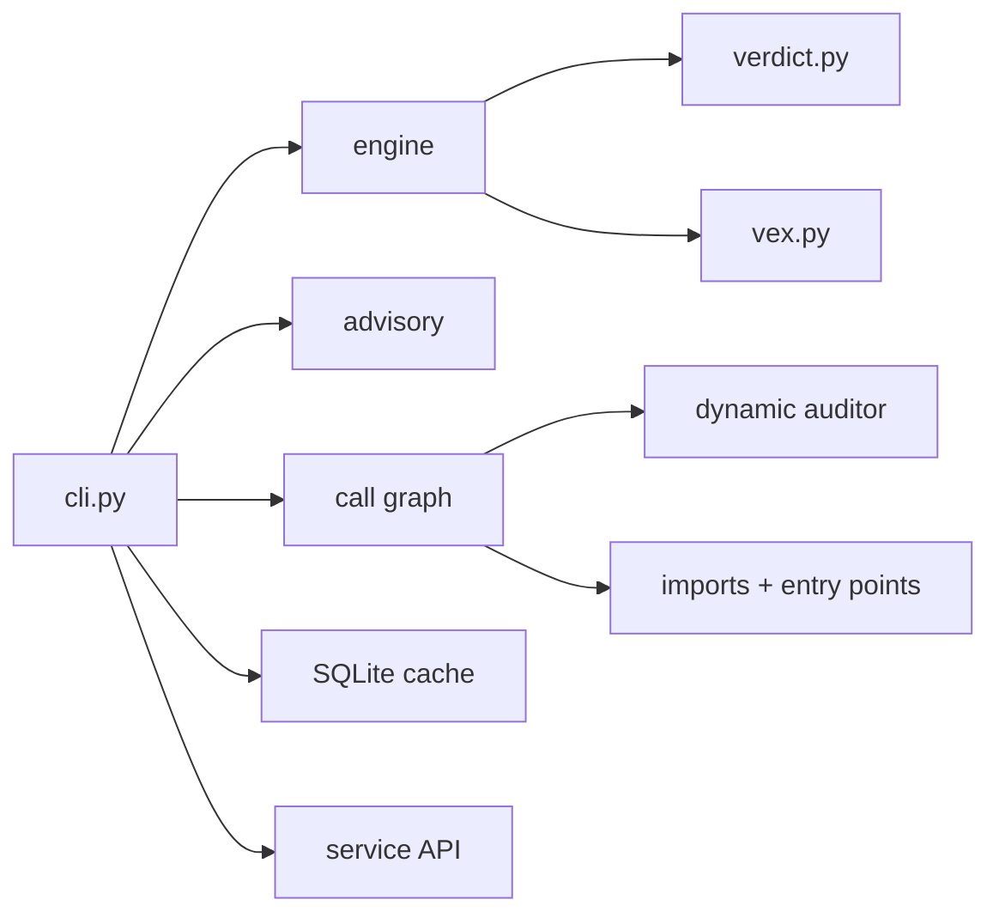

# pyreach

### Python vulnerability reachability, with evidence instead of alert fatigue

**pyreach** traces vulnerable dependency symbols from application entry points through real Python call graphs, so security teams can distinguish code that is called, code that is not called, and code that cannot be proven either way.

[](https://www.python.org/)
[](https://osv.dev/)
[](https://openvex.dev/)



> **Core rule:** pyreach is fail-safe. It never emits `NOT_REACHABLE` when missing evidence, unresolved Python dynamics, native-code boundaries, or incomplete dependency analysis could hide a call path.

---

## Why pyreach?

Dependency scanners tell you **what is present**. pyreach tries to tell you **what execution can reach**.

| Traditional package scan | pyreach |
|---|---|
| Flags every advisory in the dependency lockfile | Traces the affected symbol from app entry points |
| Imports are treated as risk | Imports, calls, re-exports, classes, and transitive edges are analyzed |
| Dynamic Python often becomes a guessing exercise | Dynamic reflection and plugin behavior fail closed to `UNCERTAIN` |
| Negative findings lack a portable artifact | `NOT_REACHABLE` findings can emit OpenVEX |
| Repeated runs repeat expensive parsing | Package summaries are cached in SQLite |

---

## The three verdicts



| Verdict | Meaning | OpenVEX |
|---|---|---|
| **REACHABLE** | A call path into an affected symbol was found. | No |
| **NOT_REACHABLE** | The analyzed entry points and call graph contain no path to the symbol. | Yes |
| **UNCERTAIN** | Analysis cannot safely prove unreachability. | No |

`REACHABLE` is a reachability result, not a claim that an input is exploitable. Sanitization, exploitability, and threat context still require human or domain-specific analysis.

---

## How it works



### Analysis pipeline

1. **Discover inputs**
   - Scan Python source and project manifests.
   - Resolve pinned dependency names and versions.
   - Load explicit advisory IDs or query OSV for pinned packages.

2. **Resolve vulnerable symbols**
   - Parse advisory fix commits and pre-fix source.
   - Map changed code to enclosing functions or classes.
   - Fall back to uncertainty when commit evidence or symbol extraction is weak.

3. **Build the call graph**
   - Discover module entry points, routes, CLI commands, and public API roots.
   - Resolve imports, aliases, re-exports, transitive calls, and CHA method targets.
   - Carry exact call-path evidence between application and dependency code.

4. **Apply the soundness firewall**
   - Audit `getattr`, dynamic imports, `eval`, `exec`, entry points, monkey-patching, native modules, and incomplete package source.
   - Convert potentially unprovable negative results into `UNCERTAIN`.

5. **Publish results**
   - Write machine-readable findings and optional OpenVEX statements.
   - Render a readable Rich terminal report or explain an existing findings file.

---

## Quick start

### Requirements

- Python **3.11+**
- Internet access for OSV and package downloads
- `pip`

### Install

```powershell
git clone https://github.com/hannuverma/python-dependencies.git
cd python-dependencies
python -m pip install -e .
```

### Scan a project

Supply advisory IDs explicitly:

```powershell
pyreach scan C:\path\to\project `
  --advisories GHSA-3f63-hfp8-52jq `
  --out .\pyreach-output
```

Or let pyreach query OSV using pinned dependencies:

```powershell
pyreach scan C:\path\to\project --out .\pyreach-output
```

Useful options:

```text
--mode app                 Application entry-point analysis (default)
--mode library             Public-API/library analysis
--limit N                  Limit queried advisories
--only-with-fix-commit     Ignore advisories without fix commits
```

### Explain prior findings

```powershell
pyreach explain .\pyreach-output\findings.json
```

### Check the CLI

```powershell
pyreach version
pyreach --help
```

---

## Three demos, three outcomes

The repository ships with a focused Pillow scenario for a clear side-by-side walkthrough.

| Case | Application behavior | Result |
|---|---|---|
| [Reachable](demo/case1_reachable) | Calls `PIL.ImageMath.eval` from `run()` | **REACHABLE** |
| [Not reachable](demo/case2_not_reachable) | Only calls `PIL.Image.new`; vulnerable code is in dead code | **NOT_REACHABLE** |
| [Uncertain](demo/case3_uncertain) | Reflectively resolves `ImageMath` with a runtime attribute name | **UNCERTAIN** |

Run the demos:

```powershell
pyreach scan demo/case1_reachable `
  --advisories GHSA-3f63-hfp8-52jq `
  --out demo/case1_reachable/out

pyreach scan demo/case2_not_reachable `
  --advisories GHSA-3f63-hfp8-52jq `
  --out demo/case2_not_reachable/out

pyreach scan demo/case3_uncertain `
  --advisories GHSA-3f63-hfp8-52jq `
  --out demo/case3_uncertain/out
```

### Reachable

```python
from PIL import ImageMath

def run():
    return ImageMath.eval("1 + 1")
```

### Not reachable

```python
def unused_dead_code():
    return ImageMath.eval("2 * 2")

def run():
    img = Image.new("RGB", (10, 10))
```

The vulnerable call is syntactically present but is not reachable from the application's entry point.

### Uncertain

```python
op = os.environ.get("PIXEL_OP", "eval")
fn = getattr(ImageMath, op)
```

A runtime environment can supply the attribute name, so pyreach preserves uncertainty instead of claiming a negative proof.

---

## Evidence, not just labels

A finding retains the evidence needed for review:

- Advisory ID and package/version
- Extracted affected symbols
- Ordered call-path hops
- Confidence level
- Exact uncertainty location and category
- Distribution filename and wheel/sdist tag
- Missing or failed dependency source
- Timestamp and analysis summary

Example finding shape:

```json
{
  "advisory_id": "GHSA-3f63-hfp8-52jq",
  "package_name": "pillow",
  "installed_version": "10.1.0",
  "verdict": "REACHABLE",
  "confidence": "high",
  "call_path": [
    "case1_reachable.main.run",
    "PIL.ImageMath.eval"
  ]
}
```

Every result is written to `findings.json`. When a `NOT_REACHABLE` statement is safe to emit, pyreach also writes `openvex.json`.

---

## OpenVEX

pyreach emits OpenVEX **only** for `NOT_REACHABLE` findings.

```json
{
  "@context": "https://openvex.dev/ns/v0.2.0",
  "statements": [
    {
      "status": "not_affected",
      "justification": "vulnerable_code_not_in_execute_path",
      "products": [
        {
          "identifiers": {
            "purl": "pkg:pypi/pillow@10.1.0"
          }
        }
      ]
    }
  ]
}
```

OpenVEX statements can feed policy engines and vulnerability workflows that understand VEX. A statement documents the pyreach analysis result; it does not replace organizational review or supply-chain policy.

---

## Handling Python's difficult parts



pyreach fail-closes for:

- Non-constant `getattr`, `setattr`, and reflection
- Dynamic imports and unresolved module strings
- `eval`, `exec`, and plugin entry points
- Monkey-patching and cross-package attribute replacement
- C extensions and fixes that modify native code
- Missing, unparsable, or incomplete dependency source
- Imprecise or LLM-derived affected-symbol evidence
- Framework roots that cannot be discovered safely

For the formal namespace-touch rules and soundness invariants, read the [architecture specification](docs/architecture.md).

---

## Cache and performance

Package summaries are stored in a deterministic SQLite cache at:

```text
~/.cache/pyreach/summary_cache.db
```

Each cached package record includes:

- Canonical package name and version
- Distribution metadata
- Parsed call graph nodes and edges
- Native modules
- Package parse statistics
- Discovered top-level modules
- Analyzer and archive identity

Cache keys account for package identity, version, archive identity, and analyzer version. Changing the analyzer invalidates stale summaries.

> Performance numbers depend heavily on network, package size, and disk state. Measure cold and warm runs in the target environment rather than extrapolating from a local demo.

---

## Docker

The included container runs pyreach as a non-root user.

```powershell
docker build -t pyreach .

docker run --rm `
  -v "${PWD}:/workspace" `
  pyreach scan /workspace/demo/case1_reachable `
  -a GHSA-3f63-hfp8-52jq `
  -o /workspace/demo/case1_reachable/out
```

The Docker image uses Python 3.11 slim, a dedicated `pyreach` user, and no privileged runtime. Package acquisition and OSV queries require network access unless the required data is already available inside the container or mounted cache workflow.

---

## API and agent service

The optional FastAPI service exposes:

| Endpoint | Purpose |
|---|---|
| `GET /` | Service status |
| `POST /scan` | Start or request analysis |
| `GET /findings/{scan_id}` | Retrieve all findings |
| `GET /findings/{scan_id}/{advisory_id}` | Retrieve one finding |
| `POST /agent/chat` | Chat with the stored-evidence PR agent |

Start it with your preferred ASGI runner:

```powershell
python -m uvicorn pyreach.service.api:app --reload
```

---

## Validation

pyreach includes focused unit and integration coverage for:

- Advisory loading and fix-commit resolution
- Call graph construction
- Dynamic feature classification
- Verdict and uncertainty guards
- Cache behavior
- Archive and package isolation
- OpenVEX generation
- Service endpoints
- Real-repository and runtime-tracer evaluation

Run the test suite:

```powershell
python -m pip install -e ".[dev]"
pytest
```

Useful repository validation tools:

```powershell
python eval/ground_truth_tracer.py
python eval/run_eval_suite.py
ruff check src tests
mypy src/pyreach
```

The runtime-tracer workflow executes benchmark entry snippets and compares runtime symbol calls with static verdicts, so a reachability miss can be detected as a hard soundness failure.

---

## Repository map



| Path | Contents |
|---|---|
| `src/pyreach/cli.py` | Scan, explain, and version commands |
| `src/pyreach/advisory/` | OSV loading, commit mining, affected-symbol resolution |
| `src/pyreach/analysis/` | AST parsing, call graphs, dynamic checks, entry points |
| `src/pyreach/engine/` | Verdicts, reports, and OpenVEX output |
| `src/pyreach/isolation/` | Package acquisition, cache, and archive isolation |
| `src/pyreach/service/` | FastAPI service and evidence-based agent |
| `demo/` | Reachable, not-reachable, and uncertain examples |
| `eval/` | Benchmarks, mutation checks, and runtime tracing |
| `docs/` | Architecture, demos, and judge Q&A |

---

## Documentation

- [Architecture overview](docs/architecture.md)
- [Architecture one-pager](docs/architecture_one_pager.md)
- [Demo script](docs/demo_script.md)
- [Judge and reviewer Q&A](docs/judge_qna.md)

---

## Limitations

pyreach is designed for evidence-backed triage, not formal whole-program proof.

- Python reflection can remain undecidable.
- Metaprogramming, serialization, plugin registries, and generated code can obscure execution roots.
- Native package behavior cannot be proven from Python AST analysis alone.
- Advisory quality varies; commit and symbol evidence may be incomplete.
- Library mode depends on the public-API roots and call patterns selected for analysis.

That is why the system treats uncertainty explicitly and caps weak evidence at `UNCERTAIN`.

---

## Contributing

Use existing project patterns, add focused tests for behavior changes, and keep the soundness rule intact:

```text
Never turn weak, incomplete, dynamic, native, or missing evidence into NOT_REACHABLE.
```
